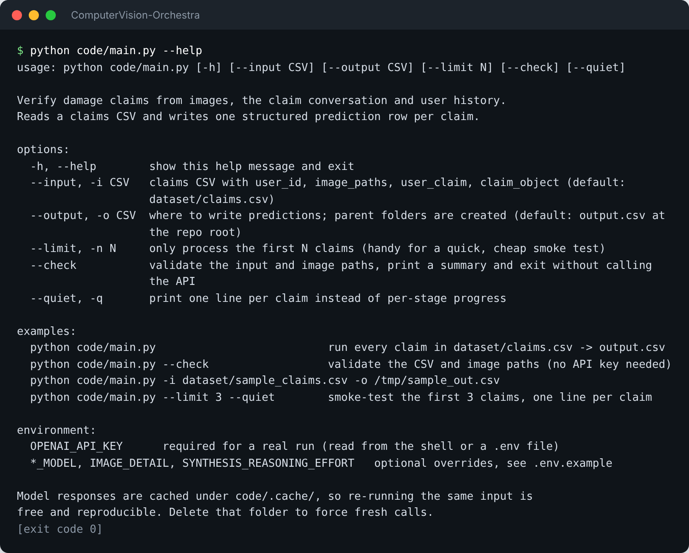
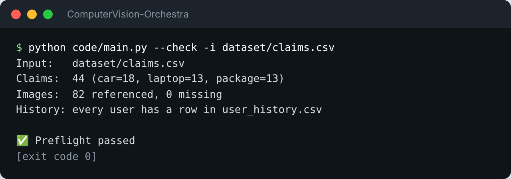
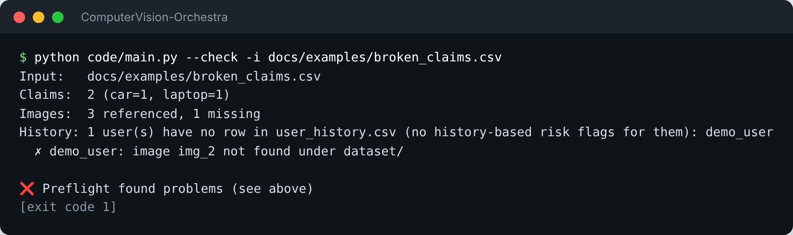
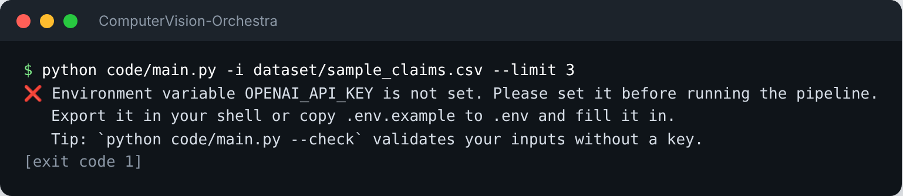
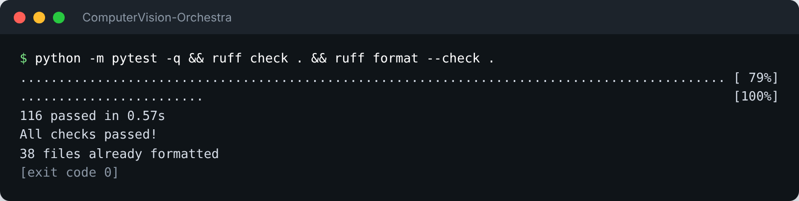
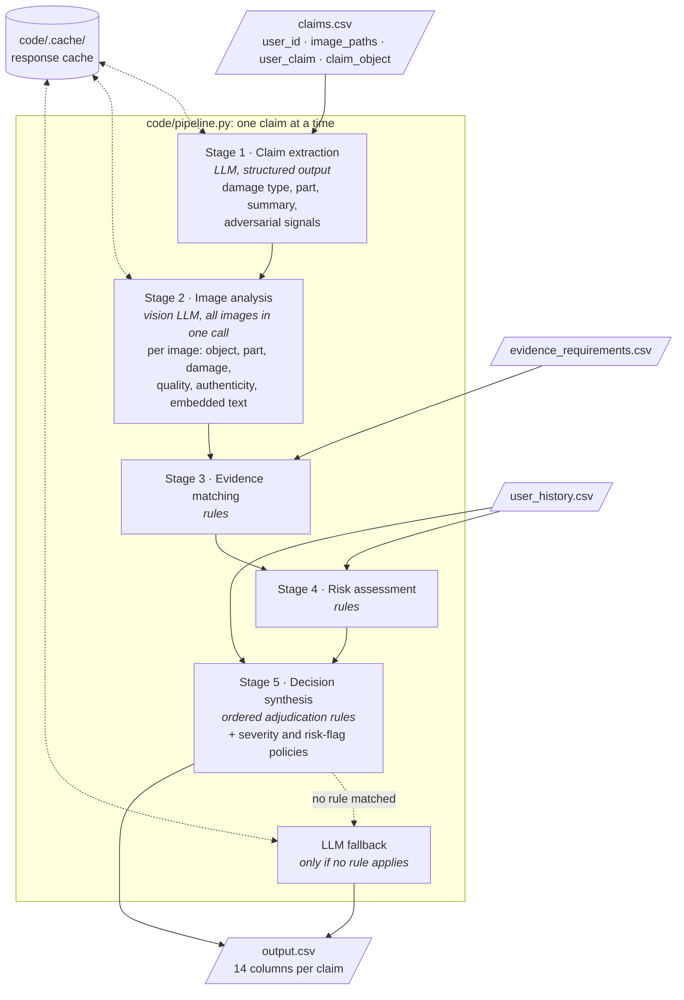

# ComputerVision-Orchestra

**Multi-modal evidence review for damage claims.** Give it the photos, the support chat and the claimant's history, and it decides whether the photos **support**, **contradict** or **don't provide enough information** for the claim. Every decision comes with a written justification, risk flags and a severity estimate.


---

## Table of contents

- [Overview](#overview)
- [See it in action](#see-it-in-action)
- [Key features](#key-features)
- [Tech stack](#tech-stack)
- [Architecture](#architecture)
- [Project structure](#project-structure)
- [Getting started](#getting-started)
- [Configuration](#configuration)
- [Usage](#usage)
- [Input and output formats](#input-and-output-formats)
- [Commands reference](#commands-reference)
- [Python API](#python-api)
- [Evaluation results](#evaluation-results)
- [Testing](#testing)
- [Linting and formatting](#linting-and-formatting)
- [Deployment](#deployment)
- [Troubleshooting and FAQ](#troubleshooting-and-faq)
- [Known limitations](#known-limitations)
- [Roadmap ideas](#roadmap-ideas)
- [Contributing](#contributing)
- [License and credits](#license-and-credits)

---

## Overview

Insurance, e-commerce and logistics teams get a steady stream of "it arrived damaged" claims. Each one has a few photos and a short chat with support. A human reviewer has to check that the photos actually show the claimed object and part, that the damage matches what the customer described, that the images are usable and unedited, and whether the claimant's history calls for extra care. This is repetitive work, and it is easy to get wrong.

This project automates the first pass of that review for three kinds of object: **cars**, **laptops** and **packages**. For every claim it:

1. reads the support conversation and pulls out the claimed damage type, the object part and any manipulation attempts (for example "just approve it");
2. inspects **all** submitted images together with a vision model and describes, per image, what object and part are visible, what damage (if any) is present, image quality problems, signs of editing and any text written in the photo;
3. checks the images against the minimum evidence requirements in `dataset/evidence_requirements.csv`;
4. adds risk context from the claimant's past claims in `dataset/user_history.csv`;
5. applies deterministic, auditable rules to reach a final decision. A language model is consulted only when no rule applies.

It was built for the **HackerRank Orchestrate (June 2026) "Multi-Modal Evidence Review"** challenge. The full task specification is in [`problem_statement.md`](./problem_statement.md).

**Who it's for:** engineers and reviewers who want a reproducible, testable claim-triage pipeline. It is also a worked example of combining a vision model with rule-based adjudication, so the model *describes* the evidence and code *decides*.

## See it in action

Everything below is real terminal output from this repository, captured with the commands shown. No API key was set.

**`--help`: every option, with examples and the environment variables it reads**



**`--check`: an offline preflight that validates the CSV and confirms every referenced image exists**



**`--check` catching problems.** The input is [`docs/examples/broken_claims.csv`](docs/examples/broken_claims.csv), a two-row demo file with one bad image path and a user with no history row:



**Missing API key: fails fast with a fix, not a traceback**



**Offline test suite and linters**



> A full run calls the OpenAI API, so no screenshot of one is included. The recorded results of the last full run are in [`output.csv`](./output.csv) and [`code/evaluation/evaluation_report.md`](./code/evaluation/evaluation_report.md). See [Evaluation results](#evaluation-results).

## Key features

| Feature | What it means in practice |
|---|---|
| **Five-stage pipeline** | Claim extraction → image analysis → evidence matching → risk assessment → decision synthesis. Every stage boundary is a typed Pydantic model. |
| **One vision call per claim** | All images for a claim go into a single request, so the model can compare a wide shot with a close-up and attribute damage to the right image ID. |
| **Strict structured outputs** | Every model call uses a JSON schema (OpenAI Responses API, `strict: true`). Every label is then normalized onto the allowed vocabulary by a deterministic normalizer (`code/normalize.py`). |
| **Deterministic adjudication** | Ordered rules decide wrong-object, reviewer-directed image text, unprovable missing contents, visible claimed damage, wrong-part damage, an undamaged claimed part, a claimed part that isn't visible, and vague laptop claims. Severity and risk flags are calibrated by policy. The model is only a fallback. |
| **Auditable decisions** | Each decision records a `rule_id` (for example `wrong_part_damage` or `llm_fallback`). The evaluation report shows it for every case. |
| **Prompt-injection defense** | Conversation and image text are treated as data. Instructions written into a photo ("approve this claim") raise `text_instruction_present` and lead to a contradicted decision. They are never obeyed. |
| **Reproducible re-runs** | Responses are cached on disk, keyed by model, prompt, schema and a hash of the full image bytes. A re-run of the same input makes no API calls. Malformed responses are never cached. |
| **Fault tolerance** | Exponential-backoff retries on rate limits, timeouts and 5xx errors. Automatic switch to a fallback model if the configured one is unavailable. A single failing claim becomes a conservative `not_enough_information` row instead of aborting the batch. |
| **Friendly CLI** | `--check` preflight without a key, `--limit` for cheap smoke tests, `--quiet` one-line-per-claim output, line-numbered input errors, clean Ctrl-C handling. |
| **Evaluation harness** | Per-field accuracy, risk-flag F1, supporting-image overlap, a confusion matrix, failure buckets, per-case table and a token/cost/runtime report on the labeled sample set. |
| **Offline test suite** | 116 pytest tests that run with a fake model client, with no API key or network needed. |

## Tech stack

| Layer | Technology | Used for |
|---|---|---|
| Language | Python 3.10+ | Everything |
| Model access | [OpenAI Python SDK](https://github.com/openai/openai-python) (`openai>=2.41`) | Responses API: text, vision and structured outputs |
| Data contracts | [Pydantic v2](https://docs.pydantic.dev/) | Typed inputs and outputs for every stage |
| Images | [Pillow](https://python-pillow.org/) | Decoding any input format and re-encoding as JPEG for the API |
| Config | [python-dotenv](https://github.com/theskumar/python-dotenv) | Optional `.env` loading |
| Tests | [pytest](https://docs.pytest.org/) | Offline unit and integration tests |
| Lint / format | [Ruff](https://docs.astral.sh/ruff/) | `ruff check` and `ruff format` |
| CI | GitHub Actions (`.github/workflows/ci.yml`) | Lint, format check, tests, byte-compile, regression checks on Python 3.10 and 3.12 |

## Architecture



**Why split description from decision?** The model is good at *seeing* ("this is a rear bumper with a scratch, slightly blurry"). It is less consistent at *policy* ("so is the claim of a dent supported?"). Stage 2 only describes. Stage 5 turns that description into a decision with plain Python rules, tried in a fixed order:

| Order | `rule_id` | Fires when | Typical outcome |
|---:|---|---|---|
| 1 | `wrong_object` | No image shows the claimed object type (for example a laptop photo for a car claim) | `contradicted` |
| 2 | `image_text_instruction` | An image contains text addressed to the reviewer | `contradicted` + `text_instruction_present` |
| 3 | `missing_contents_not_provable` | A package claim says contents are missing. A photo can't prove that. | `not_enough_information` |
| 4 | `claimed_damage_visible` | The claimed part is visible with the claimed (or a closely related) damage | `supported` |
| 5 | `wrong_part_damage` | Damage is visible, but on a different part than claimed | `contradicted` + `claim_mismatch` |
| 6 | `claimed_part_undamaged` | The claimed part is clearly visible and undamaged | `contradicted` + `damage_not_visible` |
| 7 | `claimed_part_not_visible` | The object is visible but no image clearly shows the claimed part | `not_enough_information` + `wrong_object_part` |
| 8 | `vague_laptop_physical_damage` | A vague "laptop is damaged" claim with no visible physical damage | `contradicted` |
| 9 | `llm_fallback` | None of the above. A reasoning call decides, and its image IDs are filtered to the ones actually submitted. | any |

Severity (`code/stages/policies/severity_policy.py`) and the final risk-flag set (`code/stages/policies/risk_policy.py`) are calibrated deterministically after the decision.

## Project structure

```text
.
├── code/
│   ├── main.py                       # Inference CLI: claims CSV → predictions CSV (--check, --limit, --quiet)
│   ├── pipeline.py                   # Shared 5-stage loop, CSV loading/validation, preflight, output writer
│   ├── config.py                     # Paths, model names, allowed label sets, CSV loaders, .env loading
│   ├── models.py                     # Pydantic models for every stage boundary
│   ├── llm_client.py                 # OpenAI Responses client: schemas, retries, model fallback, disk cache, token tracking
│   ├── normalize.py                  # Deterministic mapping of free-text labels onto allowed values
│   ├── prompts.py                    # System/user prompt templates for each model call
│   ├── stages/
│   │   ├── claim_extractor.py        # Stage 1: parse the conversation
│   │   ├── image_analyzer.py         # Stage 2: vision analysis, image-ID alignment, missing-file handling
│   │   ├── evidence_matcher.py       # Stage 3: minimum evidence requirements
│   │   ├── risk_assessor.py          # Stage 4: image-quality and user-history risk
│   │   ├── decision_synthesizer.py   # Stage 5: ordered adjudication rules + LLM fallback
│   │   └── policies/
│   │       ├── contradiction_policy.py   # When visible damage supports / contradicts a claim
│   │       ├── severity_policy.py        # Severity calibration
│   │       └── risk_policy.py            # Final risk-flag set
│   ├── evaluation/
│   │   ├── main.py                   # Evaluation CLI on the labeled sample set
│   │   ├── regression_checks.py      # Standalone no-API rule checks
│   │   ├── evaluation_report.md      # Last recorded evaluation (metrics, confusion matrix, cost)
│   │   ├── predictions_sample.csv    # Predicted vs expected, per sample case
│   │   └── intermediate_sample.jsonl # Every stage's output, per sample case
│   ├── requirements.txt              # Runtime dependencies
│   ├── requirements-dev.txt          # + pytest, ruff
│   ├── README.md                     # Code-level notes shipped in the submission zip
│   ├── SUBMISSION_NOTES.md           # Design rationale and trade-offs
│   └── INTERVIEW_PREP_QA.md          # Q&A on design decisions
├── dataset/
│   ├── claims.csv                    # 44 unlabeled test claims (input)
│   ├── sample_claims.csv             # 20 labeled claims for evaluation
│   ├── user_history.csv              # 47 users' past claim counts and flags
│   ├── evidence_requirements.csv     # 11 minimum-evidence rules
│   └── images/{sample,test}/case_*/  # Claim photos referenced by the CSVs
├── docs/
│   ├── screenshots/                  # Terminal captures used in this README
│   └── examples/broken_claims.csv    # Demo input that fails the preflight on purpose
├── tests/                            # 116 offline pytest tests (fake model client)
├── output.csv                        # Recorded predictions for dataset/claims.csv
├── sample_output.csv                 # Example output provided with the challenge
├── problem_statement.md              # Task specification and I/O schema
├── pyproject.toml                    # Ruff + pytest configuration
├── .env.example                      # Environment variable template
└── .github/workflows/ci.yml          # CI: lint, format, tests, byte-compile, regression checks
```

## Getting started

### Prerequisites

| Requirement | Why |
|---|---|
| Python **3.10 or newer** | Uses modern type syntax. CI tests 3.10 and 3.12. |
| `pip` (and ideally `venv`) | Dependency install |
| An **OpenAI API key** with access to a vision-capable model | Only for real inference or evaluation runs. Tests, linting and `--check` don't need it. |

### Installation

```bash
# 1. Clone
git clone https://github.com/jeevithg090/ComputerVision-Orchestra.git
cd ComputerVision-Orchestra

# 2. Create and activate a virtual environment
python -m venv .venv
source .venv/bin/activate            # Windows (PowerShell): .venv\Scripts\Activate.ps1

# 3. Install dependencies
pip install -r code/requirements.txt       # runtime only
pip install -r code/requirements-dev.txt   # runtime + pytest + ruff (recommended)

# 4. Confirm the dataset is intact (no key needed)
python code/main.py --check
```

### Add your API key

```bash
cp .env.example .env
# then edit .env and set OPENAI_API_KEY=...
```

A `.env` file in the project root or in `code/` is loaded automatically. You can also just `export OPENAI_API_KEY=...` in your shell. `.env` is git-ignored. Never commit it.

## Configuration

All configuration is through environment variables (see [`.env.example`](./.env.example)). Non-secret constants such as allowed label sets, retry limits and paths live in [`code/config.py`](./code/config.py).

| Variable | Required | Default | Description |
|---|:---:|---|---|
| `OPENAI_API_KEY` | **yes**, for inference and evaluation | none | OpenAI API key. Read from the environment or `.env` only. |
| `CLAIM_EXTRACTION_MODEL` | no | `gpt-5.5` | Model for Stage 1 (conversation parsing) |
| `IMAGE_ANALYSIS_MODEL` | no | `gpt-5.5` | Vision model for Stage 2 |
| `DECISION_SYNTHESIS_MODEL` | no | `gpt-5.5` | Model for the Stage 5 LLM fallback |
| `OPENAI_FALLBACK_MODEL` | no | `gpt-4o` | Used automatically when a configured model returns "model not found / unsupported" |
| `SYNTHESIS_REASONING_EFFORT` | no | `high` | Reasoning effort for the Stage 5 fallback: `low`, `medium` or `high` |
| `IMAGE_DETAIL` | no | `high` | Vision detail level: `high` (most accurate) or `low` (cheaper and faster) |

Fixed operational settings in `code/config.py`: up to 3 retries per call, exponential backoff from 2 s capped at 60 s, a 120 s request timeout, and the response cache in `code/.cache/`.

## Usage

All commands are run from the repository root. (`cd code && python main.py` also works, because paths are resolved from the file location.)

### 1. Validate inputs (offline)

```bash
python code/main.py --check                              # dataset/claims.csv
python code/main.py --check -i dataset/sample_claims.csv
```

This prints claim counts by object, how many images are referenced and missing, and which users have no history row. It exits `0` if everything is in place and `1` otherwise. No API calls are made.

### 2. Smoke-test a few claims

```bash
python code/main.py --limit 3 --quiet -o /tmp/smoke.csv
```

`--quiet` prints one line per claim, in this format:

```text
  [1/3] user_002   car      → supported              dent/front_bumper severity=medium (14.2s)
```

### 3. Full run on the test set

```bash
python code/main.py                                      # dataset/claims.csv → output.csv
python code/main.py -i path/to/claims.csv -o path/to/predictions.csv
```

Without `--quiet` you get per-stage progress for every claim: the extracted claim, what each image shows, whether the evidence standard was met, the risk flags and the final decision. A run ends with an operational summary: API calls, cached calls, input/output/reasoning tokens per model, and total and per-claim time.

### 4. Evaluate against the labeled sample

```bash
python code/evaluation/main.py                           # writes into code/evaluation/
python code/evaluation/main.py --limit 5 --quiet --report-dir /tmp/eval
```

This writes three files:

- `evaluation_report.md`: accuracy per field, risk-flag F1, image-ID overlap, confusion matrix, per-case table with `rule_id`, failure buckets, token usage, a cost estimate and runtime
- `predictions_sample.csv`: predicted vs expected values side by side
- `intermediate_sample.jsonl`: the full output of every stage for each case, for debugging

### 5. Re-run cheaply

Run the same command again. Every response already in `code/.cache/` is reused, so the second run is fast and makes no API calls. Delete `code/.cache/` to force fresh calls, for example after changing prompts or models.

### Exit codes

| Code | Meaning |
|---:|---|
| `0` | Success (or `--check` passed) |
| `1` | Input file missing or malformed, no claim rows, `--check` found problems, or `OPENAI_API_KEY` unset |
| `2` | Invalid command-line arguments (for example `--limit 0`) |
| `130` | Interrupted with Ctrl-C. No output file is written, but completed calls stay cached. |

## Input and output formats

### Input (`claims.csv`)

| Column | Description |
|---|---|
| `user_id` | Claimant ID, joined to `user_history.csv` |
| `image_paths` | Semicolon-separated paths, relative to `dataset/` (or absolute) |
| `user_claim` | The support conversation, turns separated by ` \| ` |
| `claim_object` | `car`, `laptop` or `package` |

Extra columns, such as the labels in `sample_claims.csv`, are ignored. The loader reports a missing column, an invalid `claim_object` (with its line number) or a non-UTF-8 file as a one-line error.

### Output (`output.csv`)

One row per input claim. All fields are quoted. The 14 columns appear in this order:

| Column | Values |
|---|---|
| `user_id`, `image_paths`, `user_claim`, `claim_object` | Copied from the input |
| `evidence_standard_met` | `true` / `false` |
| `evidence_standard_met_reason` | Short explanation |
| `risk_flags` | `;`-separated subset of `blurry_image`, `cropped_or_obstructed`, `low_light_or_glare`, `wrong_angle`, `wrong_object`, `wrong_object_part`, `damage_not_visible`, `claim_mismatch`, `possible_manipulation`, `non_original_image`, `text_instruction_present`, `user_history_risk`, `manual_review_required`, or `none` |
| `issue_type` | `dent`, `scratch`, `crack`, `glass_shatter`, `broken_part`, `missing_part`, `torn_packaging`, `crushed_packaging`, `water_damage`, `stain`, `none`, `unknown` |
| `object_part` | Allowed parts for the object (for example `rear_bumper`, `screen`, `box`; see `code/config.py`) or `unknown` |
| `claim_status` | `supported`, `contradicted`, `not_enough_information` |
| `claim_status_justification` | Grounded explanation that cites image IDs |
| `supporting_image_ids` | `;`-separated image IDs (file stem, for example `img_1`) or `none` |
| `valid_image` | `true` / `false` |
| `severity` | `none`, `low`, `medium`, `high`, `unknown` |

**Example row** (from the committed `output.csv`, shown as JSON for readability):

```json
{
  "user_id": "user_007",
  "image_paths": "images/test/case_005/img_1.jpg;images/test/case_005/img_2.jpg",
  "claim_object": "car",
  "evidence_standard_met": "true",
  "evidence_standard_met_reason": "The side_mirror is visible and the image quality is sufficient to evaluate the claim.",
  "risk_flags": "damage_not_visible;low_light_or_glare",
  "issue_type": "none",
  "object_part": "side_mirror",
  "claim_status": "contradicted",
  "claim_status_justification": "The claimed side_mirror is visible in the submitted image evidence, but no claimed damage is visible.",
  "supporting_image_ids": "img_1",
  "valid_image": "true",
  "severity": "none"
}
```

## Commands reference

| Command | Needs API key | What it does |
|---|:---:|---|
| `python code/main.py` | yes | Run every claim in `dataset/claims.csv` and write `output.csv` |
| `python code/main.py -i IN.csv -o OUT.csv` | yes | Custom input and output paths |
| `python code/main.py --limit N` | yes | Only the first N claims |
| `python code/main.py --quiet` | yes | One line per claim instead of per-stage progress |
| `python code/main.py --check` | no | Validate the CSV and image paths, then exit |
| `python code/main.py --help` | no | Full option list with examples |
| `python code/evaluation/main.py [--input CSV] [--report-dir DIR] [--limit N] [--quiet]` | yes | Evaluate against labeled data |
| `python code/evaluation/regression_checks.py` | no | Standalone rule regression checks |
| `pytest` | no | Full offline test suite |
| `ruff check .` | no | Lint |
| `ruff format .` / `ruff format --check .` | no | Format, or verify formatting |
| `python -m compileall -q code` | no | Byte-compile all sources (the CI "build" step) |

This project is a batch CLI and has no HTTP API. To call it from your own code, use the Python functions below.

## Python API

The pipeline is importable. Add `code/` to `sys.path`, or run from inside `code/`:

```python
from pathlib import Path

from config import load_user_history
from llm_client import LLMClient, TokenTracker
from pipeline import load_claims, preflight, process_claims, write_output

claims = load_claims(Path("dataset/sample_claims.csv"))[:2]
history = load_user_history()

report = preflight(claims, history)  # offline sanity check
assert report.ok, report.missing_images

client = LLMClient(tracker=TokenTracker())  # needs OPENAI_API_KEY
results = process_claims(claims, history, client)

for r in results:
    print(r.input.user_id, r.decision.claim_status, r.decision.rule_id)

write_output(results, Path("/tmp/predictions.csv"))
```

Each `ClaimResult` exposes `extraction`, `image_analysis`, `evidence_check`, `risk_profile` and `decision`, so you can inspect every stage.

## Evaluation results

These figures come from the committed [`code/evaluation/evaluation_report.md`](./code/evaluation/evaluation_report.md), recorded with `gpt-5.5` on the **20 labeled sample claims**. They are not re-measured in this repository's CI, because that needs an API key.

| Field | Accuracy |
|---|---:|
| `claim_status` | 95.0% |
| `issue_type` | 95.0% |
| `object_part` | 90.0% |
| `evidence_standard_met` | 100.0% |
| `valid_image` | 90.0% |
| `severity` | 85.0% |
| `risk_flags` (multi-label F1) | 79.1% |
| `supporting_image_ids` (overlap) | 100.0% |

An earlier LLM-first version (Chat Completions, with the model making the final decision) scored 80% / 45% / 45% on `claim_status` / `issue_type` / `severity`. Moving the decision into deterministic rules accounts for most of the improvement.

The report also logs the operational side. The sample run made 41 API calls in about 299 s (≈15 s per claim). The final test run over 44 claims and 82 images made 89 calls in about 799 s. The dollar figure in the report uses a **placeholder rate** for models missing from its small price table, so treat it as a rough indication only.

> The test set (`dataset/claims.csv`) has no labels, so accuracy on it is unknown. 20 samples is a small set, so expect a few points of variance either way.

## Testing

```bash
pip install -r code/requirements-dev.txt
pytest                 # 116 tests, about 1 s, no network, no key
pytest -k cli -v       # just the CLI tests
```

| Test file | Covers |
|---|---|
| `test_normalize.py` | Label normalization is deterministic and specific-first. Blank labels fall back to `unknown`. |
| `test_claim_extractor.py` | Stage 1 parsing and label coercion |
| `test_image_analyzer.py` | Vision-output parsing, image-ID alignment, missing and unreadable files |
| `test_evidence_and_risk.py` | Evidence requirements and risk rules (history thresholds, quality flags) |
| `test_decision.py` | Each adjudication rule, severity and risk calibration, filtering of LLM-fallback image IDs |
| `test_llm_client.py` | Retry/backoff, fallback-model switch, caching (with a fake OpenAI SDK), malformed-response handling |
| `test_pipeline.py` | End-to-end run with a fake client, fallback row on failure, output schema, CLI basics |
| `test_cli.py` | Input validation messages, `--check` preflight, `--limit`, `--quiet`, exit codes, evaluation CLI |
| `test_evaluation.py` | Metrics, confusion matrix, report generation |
| `test_output_contract.py` | The committed `output.csv` has the right columns and only allowed values |

`code/evaluation/regression_checks.py` also runs on its own (7 checks) and as part of the suite.

## Linting and formatting

[Ruff](https://docs.astral.sh/ruff/) handles both. The configuration is in `pyproject.toml`: line length 110, target `py310`, rule sets `E, F, W, I, B, UP, SIM, C4`.

```bash
ruff check .            # lint
ruff check . --fix      # lint and auto-fix
ruff format .           # format
ruff format --check .   # verify only (what CI runs)
```

## Deployment

This is a **batch job**, not a server. To run it on your own data:

1. Prepare a claims CSV with the [input columns](#input-claimscsv). Put the images under `dataset/` and reference them with relative paths, or use absolute paths.
2. If your users or evidence rules differ, replace `dataset/user_history.csv` and `dataset/evidence_requirements.csv` (same columns).
3. Run `python code/main.py --check -i your.csv`, then `python code/main.py -i your.csv -o predictions.csv`.

It runs anywhere with Python 3.10+, network access to the OpenAI API and the key in the environment: a cron job, a CI job or a container. Claims are processed sequentially to stay within rate limits. Keep `code/.cache/` between runs (for example on a mounted volume) if you want re-runs to be free.

To build the challenge submission archive:

```bash
zip -r code.zip code -x "code/.env" "code/.cache/*" "*/__pycache__/*" "*.pyc"
```

## Troubleshooting and FAQ

<details>
<summary><b><code>Environment variable OPENAI_API_KEY is not set</code></b></summary>

Export the key (`export OPENAI_API_KEY=...`) or put it in `.env` at the project root or in `code/`. Check that `python-dotenv` is installed (it is in `requirements.txt`). Use `--check` to validate inputs without a key.
</details>

<details>
<summary><b><code>ModuleNotFoundError: No module named 'pydantic'</code> (or <code>openai</code>) when running <code>pytest</code></b></summary>

Your `pytest` is probably a globally installed copy that runs a different Python than your virtualenv. Run `python -m pytest` so it uses the interpreter where you installed `code/requirements-dev.txt`.
</details>

<details>
<summary><b><code>--check</code> reports <code>image img_N not found under dataset/</code></b></summary>

Image paths are resolved relative to the `dataset/` folder, not to the CSV's location or your current directory. Use paths like `images/test/case_001/img_1.jpg`, or absolute paths. At runtime a missing image doesn't crash the run: it is marked unreadable and the claim is judged on the remaining images.
</details>

<details>
<summary><b><code>claim_object must be one of car, laptop, package</code></b></summary>

Only these three object types have part vocabularies and evidence rules. Check the reported line number for a typo or stray whitespace.
</details>

<details>
<summary><b>Rate limits or timeouts</b></summary>

The client retries rate limits, timeouts and connection errors up to 3 times with exponential backoff (2 s → 60 s cap), and retries 5xx errors too. If you still hit limits, use `IMAGE_DETAIL=low`, process smaller batches with `--limit`, or raise your account's limits. Finished calls are cached, so restarting doesn't repeat them.
</details>

<details>
<summary><b>"Model not found" or "unsupported model"</b></summary>

If a configured model is unavailable to your account, the client switches to `OPENAI_FALLBACK_MODEL` (default `gpt-4o`) once and continues. To choose models explicitly, set `CLAIM_EXTRACTION_MODEL`, `IMAGE_ANALYSIS_MODEL` and `DECISION_SYNTHESIS_MODEL`.
</details>

<details>
<summary><b>I changed a prompt but the results didn't change</b></summary>

The cache key includes the prompt, so changed prompts do produce new calls. If you changed normalization or policy code, though, no model call changes and the cached descriptions are reused. That is expected: only the deterministic layer re-runs. Delete `code/.cache/` to force everything to re-run.
</details>

<details>
<summary><b>One claim shows <code>❌ ... wrote a conservative not_enough_information row</code></b></summary>

That claim raised an unexpected error. The traceback is printed below the message. The batch continues, and that row gets `claim_status=not_enough_information` and `manual_review_required`, so a human looks at it.
</details>

## Known limitations

- **Small labeled set.** Accuracy is measured on 20 sample claims. Accuracy on the 44 unlabeled test claims is unknown.
- **Missing contents can't be proven from photos.** Those package claims are deliberately returned as `not_enough_information`.
- **Hosted-model dependence.** Results can drift if the provider changes model behavior. The cache pins responses already seen, but a cold cache can give slightly different descriptions.
- **Recorded artifacts predate the latest fixes.** `output.csv` and `code/evaluation/*` come from the last full run. The later robustness fixes (label normalization, image-ID alignment) only change behavior for off-vocabulary labels or missing files, but the artifacts have not been regenerated.
- **Sequential processing.** About 15–18 s per claim. Fine for hundreds of claims, slow for tens of thousands.
- **Two "related damage" groupings.** `risk_assessor.py` and `contradiction_policy.py` each define related damage types, and the policy also treats `broken_part` as related to `crack`. They are kept separate on purpose, because merging them would change outputs.
- **Fixed vocabularies.** New object types or damage labels need changes to `code/config.py`, the prompts and the evidence requirements.

## Roadmap ideas

- Concurrent claim processing with a token-bucket rate limiter
- Regenerate `output.csv` and the evaluation report under the current code, and track metrics over time
- A larger labeled set, with per-object and per-rule accuracy
- Merge the two related-damage groupings into one tested definition
- An optional JSON Lines output with per-stage details for downstream review tools
- A small review UI that shows each claim's images next to the decision and `rule_id`

## Contributing

1. Create a branch from `main`.
2. Install dev dependencies: `pip install -r code/requirements-dev.txt`.
3. Make your change and add or adjust tests in `tests/`. Keep them offline by using `FakeClient` from `tests/conftest.py`.
4. Run `ruff check . && ruff format --check . && python -m pytest` before you open a pull request. CI runs the same checks.
5. Keep decision logic deterministic. If you add an adjudication rule, give it a unique `rule_id` and a test, and keep the order in `decision_synthesizer.py` deliberate.
6. Never commit `.env`, API keys or `code/.cache/`.

## License and credits

No license file is included yet, so default copyright applies and others may not reuse the code. If you want others to use it, consider adding a permissive license such as **MIT** or **Apache-2.0**.

The task, the dataset (claims, user history, evidence requirements and images) and the original starter layout come from the **HackerRank Orchestrate (June 2026)** challenge. They remain subject to HackerRank's terms and are not covered by any license added to this code.
